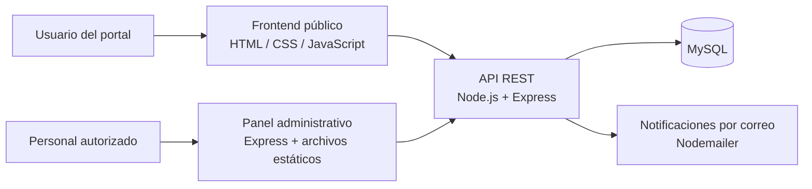

<div align="center">

# AutoReclamo

### Plataforma Full Stack para la Gestión de Reclamos por Siniestros Automovilísticos

**Digitalización de procesos · Seguimiento de reclamos · Gestión administrativa**


[**Ver demostración**](https://autoreclamo-frontend.vercel.app/) · [**Código fuente**](https://github.com/CharlesMatiasOl/Proyecto-tesis-AutoReclamo-Local)

</div>

---

## Descripción del proyecto

**AutoReclamo** es una plataforma web Full Stack destinada a digitalizar y centralizar la presentación, administración y seguimiento de reclamos de terceros por siniestros automovilísticos.

La solución reúne en un mismo sistema el ingreso de información, el seguimiento de estados y la gestión operativa de reclamos, reduciendo la dependencia de tareas manuales y facilitando la trazabilidad de cada caso. Se desarrolló como proyecto final de formación académica, vinculado a una necesidad empresarial real.

### Problema que aborda

La carga, búsqueda y actualización manual de información dificulta la organización de los expedientes, aumenta los tiempos de atención y reduce la visibilidad del estado de cada trámite.

### Solución implementada

Una aplicación con dos experiencias diferenciadas:

- **Portal público:** permite presentar reclamos, aportar información y archivos, consultar el estado mediante un código de seguimiento y contactar al equipo.
- **Panel administrativo:** centraliza clientes y reclamos, permite consultar y actualizar casos, registrar comentarios y visualizar indicadores operativos.

## Impacto y contribución

El trabajo de digitalización y optimización se asoció con los siguientes resultados estimados del proyecto:

- **≈ 80 % de reducción del trabajo manual** vinculado a la carga, búsqueda y seguimiento de información.
- **≈ 60 % de mejora en tiempos de respuesta** de operaciones frecuentes mediante optimización de consultas y estructuras de datos.
- Centralización de información, mejor seguimiento de estados y mayor disponibilidad de herramientas para la gestión administrativa.

## Demostración visual

<div align="center">
  
  <p><em>Portal de presentación y seguimiento de reclamos.</em></p>
  
  <p><em>Herramientas de administración y gestión de casos.</em></p>
</div>

**Demo pública:** https://autoreclamo-frontend.vercel.app/

## Funcionalidades principales

| Módulo | Funcionalidades |
|---|---|
| **Portal público** | Formulario multipaso, validaciones, carga de imágenes y documentos del reclamo, seguimiento por código y contacto. |
| **Gestión administrativa** | Inicio de sesión, listado y detalle de reclamos, gestión de clientes, actualización de estados y registro de comentarios. |
| **Dashboard** | Consulta de estadísticas y métricas de reclamos. |
| **Backend** | APIs REST, reglas de negocio, validación de datos, persistencia relacional e integración con correo electrónico. |

## Arquitectura de la solución

La aplicación está distribuida en tres componentes dentro del repositorio:

```text
Proyecto-tesis-AutoReclamo-Local/
├── frontend/                 # Portal público: HTML, CSS y JavaScript
│   ├── index.html
│   ├── reclamos.html
│   ├── seguimiento.html
│   ├── contacto.html
│   ├── estilos/
│   └── scripts/
├── backend/                  # API REST y lógica de negocio
│   ├── app.mjs
│   ├── funciones.mjs
│   └── package.json
└── auto-reclamo-admin/       # Servidor y panel administrativo
    ├── app.mjs
    ├── public/
    └── package.json
```



**Decisiones técnicas destacadas:** separación del portal público, la API y el panel administrativo; uso de consultas parametrizadas con `mysql2`; sesiones administrativas mediante cookies; y validación de datos tanto en cliente como en servidor.

## Tecnologías utilizadas

| Capa | Tecnologías |
|---|---|
| Frontend público | HTML5, CSS3, JavaScript |
| Backend | Node.js, Express.js, APIs REST |
| Base de datos | MySQL, `mysql2` |
| Seguridad y validación | Helmet, CORS, `express-validator`, `express-rate-limit`, autenticación y sesiones administrativas |
| Archivos y notificaciones | Multer, Sharp, Nodemailer |
| Herramientas | Git, GitHub, Postman |

### Seguridad y control de acceso

La API contempla, entre otras medidas, validación de solicitudes, políticas CORS configurables, cabeceras mediante Helmet, limitación de peticiones y control de sesiones administrativas. La carga de imágenes tiene restricciones de formato, tamaño y cantidad. Estas medidas no sustituyen una auditoría de seguridad antes de publicar el servicio.

## API REST — ejemplos de endpoints

| Método | Ruta | Función |
|---|---|---|
| `POST` | `/reclamo` | Registrar un reclamo. |
| `GET` | `/seguimiento/:codigo` | Consultar el estado mediante código. |
| `POST` | `/contacto` | Enviar un mensaje de contacto. |
| `POST` | `/reclamo/:codigo/imagenes` | Adjuntar imágenes a un reclamo. |
| `POST` | `/api/admin/login` | Iniciar sesión administrativa. |
| `GET` | `/api/clientes` | Consultar clientes (requiere sesión). |
| `GET` | `/api/reclamos` | Consultar reclamos (requiere sesión). |
| `GET` | `/api/estadisticas/reclamos` | Obtener estadísticas para el panel (requiere sesión). |

Las rutas administrativas requieren autenticación, salvo el inicio de sesión. Los contratos completos deben consultarse en `backend/app.mjs`.

## Instalación y ejecución local

### Requisitos

- Node.js 18 o superior (recomendación del proyecto original).
- npm.
- MySQL con la base de datos y tablas necesarias para el sistema.


### 1. Clonar el repositorio

```bash
git clone https://github.com/CharlesMatiasOl/Proyecto-tesis-AutoReclamo-Local.git
cd Proyecto-tesis-AutoReclamo-Local
```

### 2. Instalar las dependencias del backend

```bash
cd backend
npm install
```

Crear un archivo `backend/.env` con valores propios del entorno. Ejemplo **sin credenciales reales**:

```dotenv
NODE_ENV=development
PORT=3000
DB_HOST=127.0.0.1
DB_USER=usuario_local
DB_PASSWORD=tu_clave_local
DB_NAME=autoreclamo
SIGNED_IMAGE_SECRET=generar_un_secreto_aleatorio_largo
CORS_ORIGINS=http://localhost:3000,http://localhost:8082

# Para funcionalidades de correo electrónico:
EMAIL_USER=correo_de_pruebas@ejemplo.com
EMAIL_PASS=credencial_del_servicio

# Para crear o actualizar un usuario administrador inicial:
ADMIN_EMAIL=admin@ejemplo.com
ADMIN_PASSWORD=usar_una_clave_segura_de_10_o_mas_caracteres
```

No subas el archivo `.env` ni credenciales a GitHub. El backend exige `SIGNED_IMAGE_SECRET`; si definís `ADMIN_EMAIL`, también debés definir `ADMIN_PASSWORD` (de al menos 10 caracteres).

Desde el directorio `backend/`, iniciar el servidor:

```bash
node app.mjs
```

La API se inicia de manera predeterminada en **http://localhost:3000**, y este mismo servidor también publica los archivos del frontend público.

### 3. Levantar el panel administrativo (otra terminal)

Desde la raíz del repositorio:

```bash
cd auto-reclamo-admin
npm install
npm start
```

Por defecto, el panel queda disponible en **http://localhost:8082**. Para modificar el puerto se puede configurar `ADMIN_PORT` en el entorno del panel.

### 4. Acceso y configuración

- **Portal público:** http://localhost:3000
- **Panel administrativo:** http://localhost:8082
- **API:** http://localhost:3000

Los scripts del portal y del administrador utilizan por defecto `http://localhost:3000` como API cuando se ejecutan localmente en puertos diferentes. Si modificás los dominios o puertos, también debés revisar la configuración de URL base y CORS.

## Responsabilidades y aprendizaje técnico

En este proyecto participé en el relevamiento de necesidades, definición de flujos operativos, desarrollo frontend y backend, modelado de datos, integración de endpoints, validaciones y mantenimiento de funcionalidades.

El trabajo permitió profundizar conocimientos en diseño de aplicaciones orientadas al negocio, separación de responsabilidades, tratamiento de errores, seguridad de APIs y transformación de procesos manuales en herramientas digitales.

## Estado del proyecto

Repositorio académico y demostrativo basado en una solución para un escenario empresarial. Algunas funciones dependen de una base de datos configurada y de servicios externos (por ejemplo, correo electrónico). La publicación del código no implica que exista un entorno de prueba con credenciales administrativas públicas.

---

<div align="center">

**Desarrollado por Charles Matias de Oliveira**

[GitHub](https://github.com/CharlesMatiasOl) · [LinkedIn](https://www.linkedin.com/in/charlesmatias/) · [Portafolio](https://charles-matias.vercel.app/)

</div>
